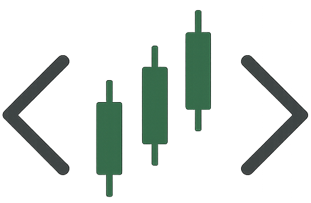
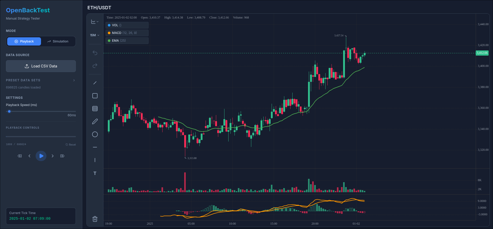
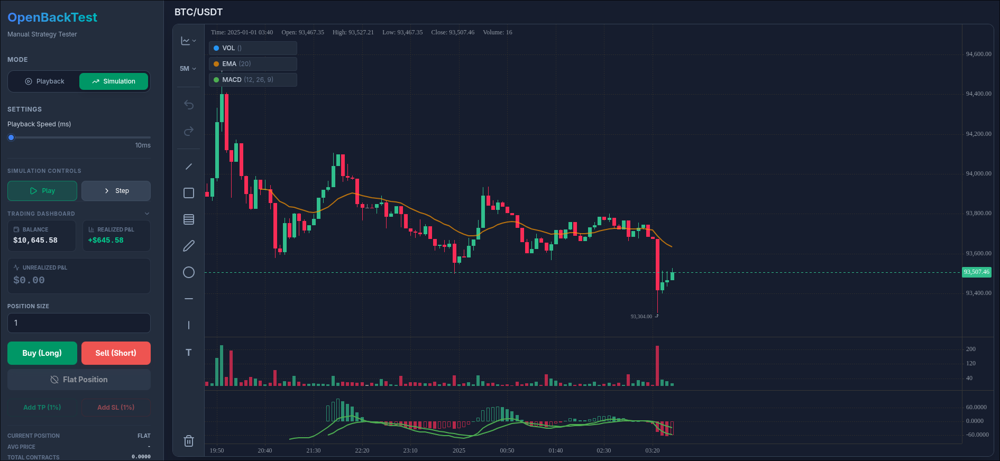
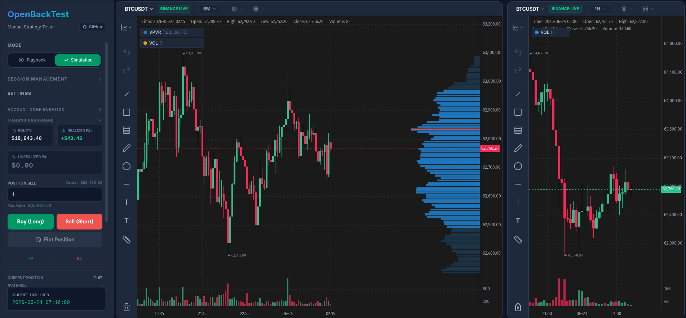
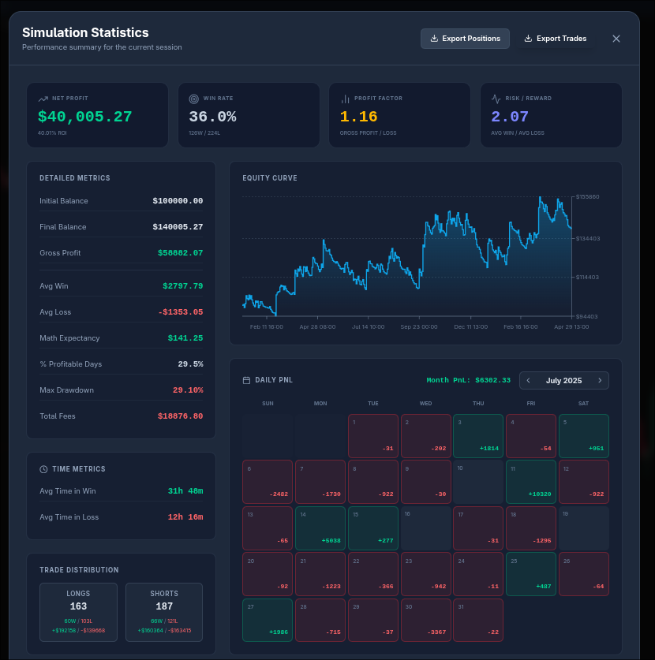

#  OpenBackTest

[Open in browser](https://binarymasc.github.io/OpenBackTest/)

OpenBackTest is an open-source browser tool for technical analysis and manual backtesting. Use it to study live charts or replay historical candles to test a trading strategy.

For development commands, architecture, and testing conventions, see the [contributor guide](AGENTS.md).

**Playback**


**Trade Panel**


**Binance Live Data Feed**


**Simulation Statistics**


### Features

- Import historical data and visualize it on a chart.
- Simulate market data realtime.
- Backtest with your trading strategy.
- Analyze price action with lines, Fibonacci retracements, and indicators such as FVG and Anchored VWAP.
- Live broker data (Rithmic, Binance)
- Live order execution.

### Data import format

```
datetime,open,high,low,close,volume,symbol
YYYY-MM-DD HH:mm:ss,open,high,low,close,volume,symbol
```

### Execute locally
```sh
npm install
npm run build
npm run dev
```

### Rithmic market data and live account

OpenBackTest includes a Rithmic provider for the Phidias paper-trading profile
(Rithmic Paper Trading / Chicago Area). The Live Trade mode shows broker
account statistics and can route market orders, cancel orders, and flatten a
position through the local .NET RAPI+ gateway. See
[`gateway/README.md`](gateway/README.md) for setup and live-mode precautions.

Start the gateway, start OpenBackTest, then choose **Connect with Rithmic
credentials** in the data controls. Credentials are entered in the browser and
forwarded only to the local gateway; they are not part of the repository.

### Testing
The project uses `vitest` and `@testing-library/react` for unit testing. All tests are located in the `tests/` directory.

```sh
npm run test       # Run test suite
npm run coverage   # Run tests with coverage report
```

### To-Do
- [ ] Chart: CTRL+C and CTRL+V to copy and paste overlays.
- [ ] Custom Indicators (Engine): Ability to load dynamic scripts with indicators or strategies in execution-time.
- [ ] Expert Advisors (Engine): Algorithmic trading and backtest engine integration.
- [ ] Data and trading: Live trading Binance.
- [ ] Data and trading: data feed and trading Bitget.
- [ ] Chart: Advanced volume indicators (liquidity and large orders), where supported by the data feed.
